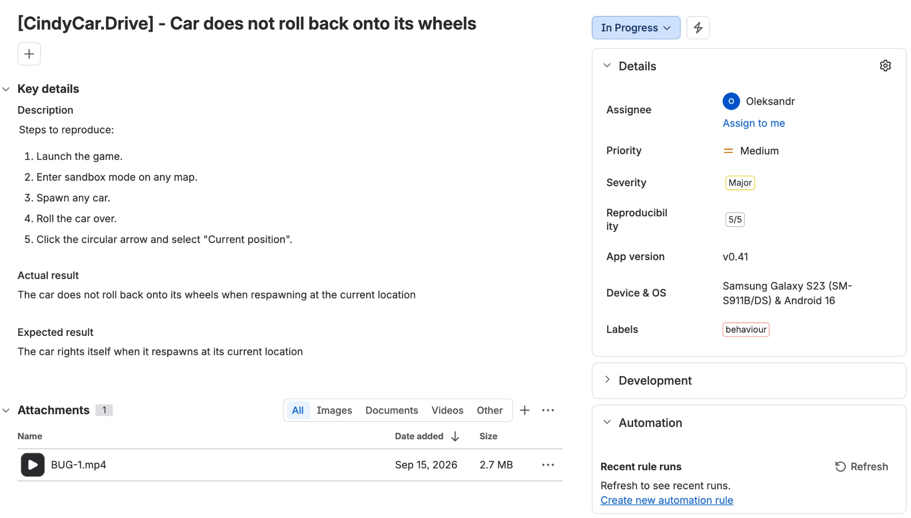

# BUG-001 · Car does not roll back onto its wheels after respawn at current position

[← Back to bug reports](README.md)

| Field | Value |
|---|---|
| **Game** | CindyCar.Drive |
| **Build** | v0.41 |
| **Device** | Samsung Galaxy S23 (SM-S911B/DS), Android 16 |
| **Severity** | Major |
| **Priority** | Medium |
| **Reproducibility** | 5/5 |
| **Labels** | behaviour |

## Steps to reproduce

1. Launch the game
2. Enter sandbox mode on any map
3. Spawn any car
4. Roll the car over
5. Tap the circular arrow and select "Current position"

## Actual result

The car does not roll back onto its wheels when respawning at the current position.

## Expected result

The car rights itself when it respawns at its current position.

## Attachments

- 🎬 [Video](../assets/bug-001.mp4)
- 🖼 Report in the bug tracker:

