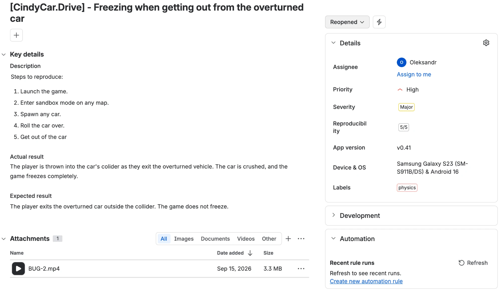

# BUG-002 · Game freezes when the player gets out of an overturned car

[← Back to bug reports](README.md)

| Field | Value |
|---|---|
| **Game** | CindyCar.Drive |
| **Build** | v0.41 |
| **Device** | Samsung Galaxy S23 (SM-S911B/DS), Android 16 |
| **Severity** | Major |
| **Priority** | High |
| **Reproducibility** | 5/5 |
| **Labels** | physics |

## Steps to reproduce

1. Launch the game
2. Enter sandbox mode on any map
3. Spawn any car
4. Roll the car over
5. Get out of the car

## Actual result

The player is thrown into the car's collider while exiting the overturned vehicle. The car is crushed, and the game freezes completely.

## Expected result

The player exits the overturned car outside the collider. The game does not freeze.

## Attachments

- 🎬 [Video](../assets/bug-002.mp4)
- 🖼 Report in the bug tracker:

