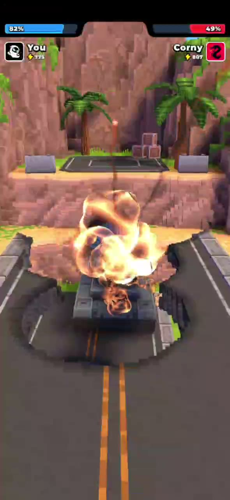
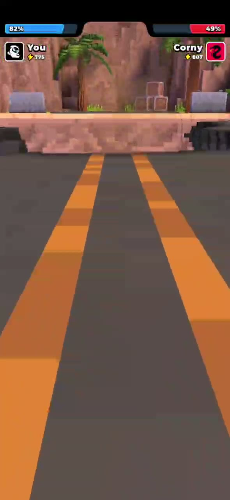

# BUG-005 · Hidden bridge collision blocks all damage after the enemy falls under the bridge - level soft-lock

[← Back to bug reports](README.md)

| Field | Value |
|---|---|
| **Game** | Tank Busters (com.tank.busters) |
| **Build** | 1.1.1 (118) |
| **Device** | Samsung Galaxy S23 (SM-S911B), Android 16 |
| **Severity** | Critical |
| **Priority** | Urgent |
| **Reproducibility** | 5/5 |

## Steps to reproduce

1. Launch the game
2. Start a level where the enemy tank stands on a bridge
3. Destroy the part of the bridge behind the enemy
4. Knock the enemy tank off the bridge so it lands under the bridge

## Actual result

- Shells visually explode on the enemy tank, but the hidden collision of the destroyed bridge absorbs the hit.
  The enemy HP does not change.
- The enemy cannot damage the player either.
- Neither side can win, and there is no way to leave the level - the game has to be restarted.

## Expected result

- The bridge collision matches its visible model. Shells that fly under the bridge reach the enemy and deal damage.
- The level can always be finished.

## Additional issue - camera clips into the bridge

Before the enemy's turn, the camera zooms in on the enemy tank under the bridge. On the way it flies
inside the bridge model and shows the road texture from the inside instead of the enemy.

## Attachments

- 🎬 [Video](../assets/bug-005.mp4)

| Shell explodes on the enemy, HP stays at 49% | Camera inside the bridge texture |
|---|---|
|  |  |

## Notes

- No crash - the game keeps running, but the level cannot be completed (soft-lock)
- Workaround: none inside the level - only force close and restart the game
