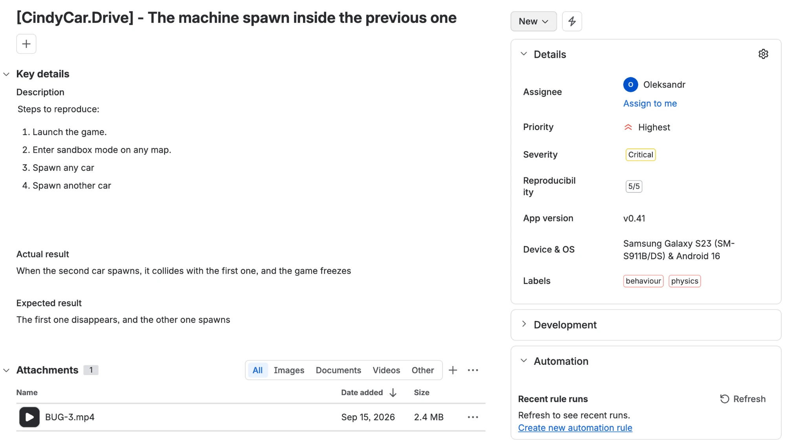
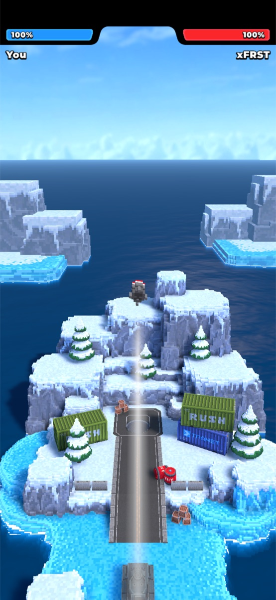
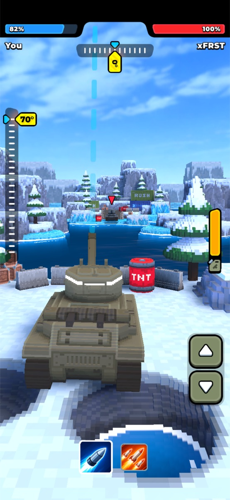
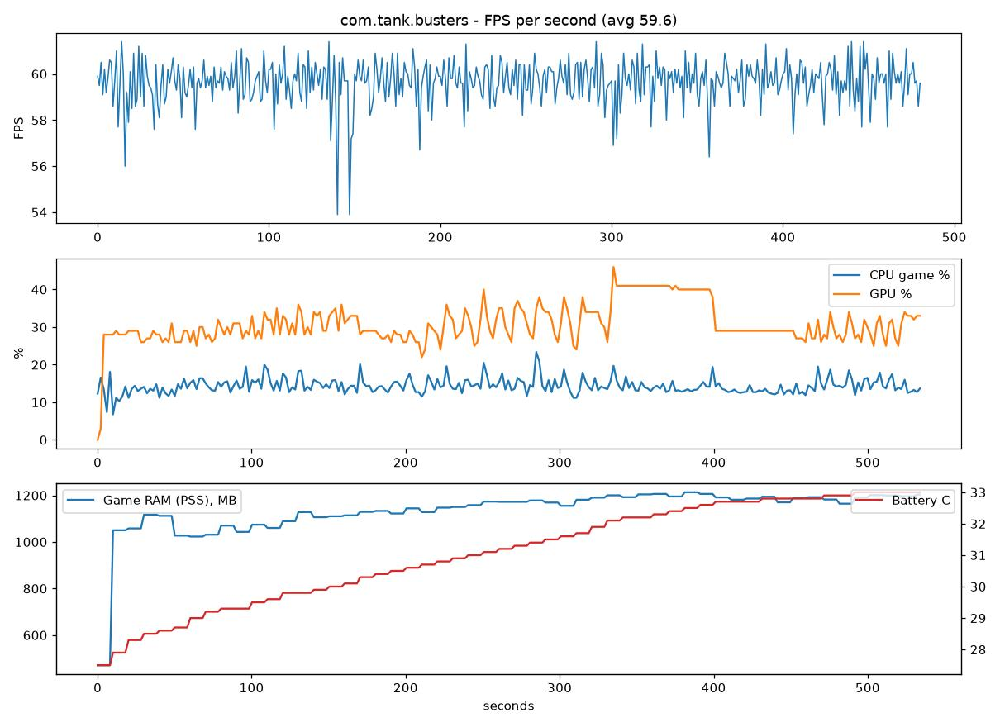
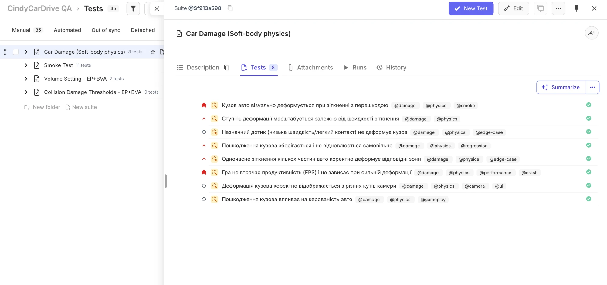
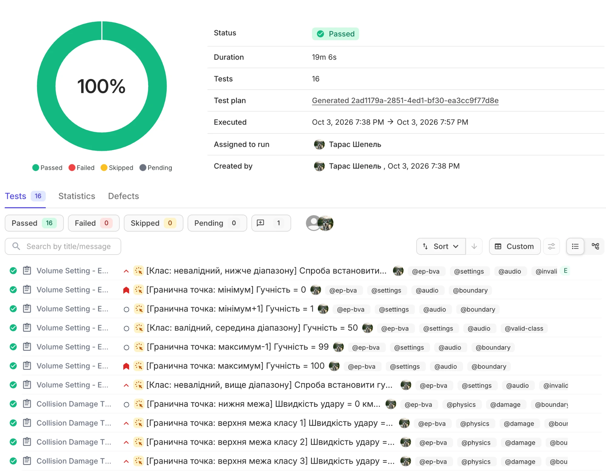

# 🎮 Game QA Portfolio

**Taras Shepel** · Game QA Engineer · Cherkasy, Ukraine

[LinkedIn](https://www.linkedin.com/in/taras-shepel-a38299447/) · [Email](mailto:shepel.taras@ukr.net) · [perfgrab tool](https://github.com/shepel04/Perfgrab)

---

## 👋 About

Game QA engineer with a Python automation background. I test mobile and PC games: functional,
interruption, performance, compatibility and balance testing. I also build my own QA tools -
see [perfgrab](https://github.com/shepel04/Perfgrab), a desktop app for automated performance
and interruption testing of Android games over adb.

**Core skills:** test design (checklists, test cases, pairwise, EP + BVA) · test management in Testomat.io ·
bug reporting · performance testing · interruption testing · requirements analysis · adb · Python automation

---

## 📂 Contents

| # | Section | Game / Platform | Highlights |
|---|---|---|---|
| 01 | [Bug reports](01-bug-reports/) | CindyCar.Drive, Tank Busters · Android | 5 bugs, 2 critical |
| 02 | [Interruption checklist](02-checklists/interruptions-tank-busters/) | Tank Busters · Android | 16 checks, 13 automated via adb · 15 Passed, 1 Failed |
| 03 | [Non-functional checklist](02-checklists/non-functional-rocket-league/) | Rocket League · PC | 25 checks, 10 test types, all Passed |
| 04 | [Pairwise testing](03-test-design/pairwise-rocket-league/) | Rocket League · PC | 16 cases instead of 96 |
| 05 | [Performance testing](04-performance-testing/) | Tank Busters · Android | FPS, CPU, GPU, RAM, temperature |
| 06 | [Test management](#-06--test-management---testomatio) | CindyCarDrive · Testomat.io | 35 test cases, 4 suites, manual runs |
| 🛠 | [perfgrab](https://github.com/shepel04/Perfgrab) | Android | My own QA tool |

---

## 🐞 01 · Bug reports

| ID | Summary | Game | Severity | Priority | Evidence |
|---|---|---|---|---|---|
| [BUG-001](01-bug-reports/BUG-001.md) | Car does not roll back onto its wheels after respawn at current position | CindyCar.Drive | Major | Medium | [video](assets/bug-001.mp4) |
| [BUG-002](01-bug-reports/BUG-002.md) | Game freezes when the player gets out of an overturned car | CindyCar.Drive | Major | High | [video](assets/bug-002.mp4) |
| [BUG-003](01-bug-reports/BUG-003.md) | New car spawns inside the previous one and the game freezes | CindyCar.Drive | Critical | Urgent | [video](assets/bug-003.mp4) |
| [BUG-004](01-bug-reports/BUG-004.md) | Game does not pause when an alarm/timer goes off during a battle | Tank Busters | Moderate | Medium | [screenshots](01-bug-reports/BUG-004.md#attachments) |
| [BUG-005](01-bug-reports/BUG-005.md) | Hidden bridge collision blocks all damage after the enemy falls under the bridge - level soft-lock | Tank Busters | Critical | Urgent | [video](assets/bug-005.mp4) |

<b>BUG-003 · Example of a full report</b>

| Field | Value |
|---|---|
| **Summary** | New car spawns inside the previous one and the game freezes |
| **Steps to reproduce** | 1. Launch the game 2. Enter sandbox mode on any map 3. Spawn any car 4. Spawn another car |
| **Actual result** | The second car spawns inside the first one, they collide, and the game freezes |
| **Expected result** | The first car disappears and the second one spawns in its place |
| **Device** | Samsung Galaxy S23 (SM-S911B/DS), Android 16 |
| **Build** | v0.41 |
| **Severity / Priority** | Critical / Urgent |
| **Reproducibility** | 5/5 |
| **Attachments** | [video](assets/bug-003.mp4) |

---

## ✅ 02 · Interruption checklist - Tank Busters

| Game | Platform | Device | Tools |
|---|---|---|---|
| Tank Busters | Android | Samsung Galaxy S23, Android 16 | adb, perfgrab |

**Task:** check how the game handles interruptions - calls, notifications, Home, lock screen, network loss, battery events.
**Approach:** 16 checks in 5 categories. 13 triggered automatically over adb, 1 assisted, 2 manual.
**Result:** 15 Passed · 1 Failed (pass rate 94%, 26.7 min). TC-8 failed: the game does not pause when the alarm goes off → [BUG-004](01-bug-reports/BUG-004.md).

📄 [Checklist (xlsx)](02-checklists/interruptions-tank-busters/checklist.xlsx) · 📊 [Run report](02-checklists/interruptions-tank-busters/report.md)

| Before the alarm | After dismissing the alarm |
|---|---|
|  |  |

---

## ✅ 03 · Non-functional checklist - Rocket League

| Game | Platform | Test types |
|---|---|---|
| Rocket League | PC (Epic Games) | Performance · Compatibility · Usability · Localization · Network · Installation · Security · Accessibility · Audio · Stability |

**Task:** build a checklist with non-functional checks of different types.
**Result:** 25 checks, prioritized High / Medium / Low. All 25 executed - 25 Passed.

📄 [Checklist (Google Sheets)](https://docs.google.com/spreadsheets/d/1I3fSWyucftm2tldW_8a010RV_gJs2XAhovh_i8H6Zrk/edit)

---

## 🧮 04 · Pairwise testing - Rocket League

**Parameters (3-4-4-2):**

| Game mode | Car body | Arena | Playlist |
|---|---|---|---|
| Duel (1v1) | Octane | DFH Stadium | Casual |
| Doubles (2v2) | Dominus | Mannfield | Competitive |
| Standard (3v3) | Fennec | Champions Field | |
| | Breakout | Urban Central | |

- All combinations: 3 × 4 × 4 × 2 = **96**
- Pairwise: 4 × 4 = **16** (two largest groups) - every pair of values appears at least once

> [!TIP]
> Most defects come from a single parameter or an interaction of two. Pairwise covers all of them with 6× fewer test runs.

📄 [Pairwise table (Google Sheets)](https://docs.google.com/spreadsheets/d/1YwYVJbzzYSanFifmXo1UiStdeNZvo067SmT_NqpbhKs/edit)

---

## 📈 05 · Performance testing

| Game | Device | Settings | Duration | Tool |
|---|---|---|---|---|
| Tank Busters | Samsung Galaxy S23, Android 16 | Default | ~9 min | perfgrab (adb) |

| Avg FPS | Min / Max FPS | Avg CPU | Avg GPU | RAM (PSS) | Battery °C (start → end) |
|---|---|---|---|---|---|
| 59.6 | ~54 / ~61 | ~14% | ~30% | ~1050 → 1200 MB | 27.5 → 33.0 |

**Conclusion:** FPS is stable at the 60 FPS cap with only two short drops to ~54. CPU and GPU load is low, RAM levels off at ~1200 MB, and the phone does not overheat (+5.5 °C in 9 min).

---

## 🗂 06 · Test management - Testomat.io

| Project | Tool | Test cases | Suites |
|---|---|---|---|
| CindyCarDrive QA | Testomat.io | 35 manual | 4 |

**Task:** organize test documentation for a car driving game in a test management system and run the tests manually.

**Test suites:**

| Suite | Tests | Focus |
|---|---|---|
| Smoke Test | 11 | Core functionality |
| Car Damage (Soft-body physics) | 8 | Deformation, speed scaling, camera angles, FPS under heavy damage, handling |
| Volume Setting - EP+BVA | 7 | Equivalence partitioning + boundary values for the 0-100 volume range |
| Collision Damage Thresholds - EP+BVA | 9 | Impact speed boundaries for each damage class |

**Approach:**
- Each test case has a priority (critical / high / normal) and tags for filtering: `@smoke`, `@regression`, `@damage`, `@physics`, `@audio`, `@ep-bva`, `@boundary`, `@edge-case`, `@performance` and others
- Test design techniques are visible in test titles: `[Boundary: minimum] Volume = 0`, `[Invalid class, above range] ...`
- Manual runs created from a test plan, each test marked Passed / Failed / Skipped

**Result:** manual run of the EP + BVA suites - 16 tests, 16 Passed, 19 min.

---

## 🛠 Tools I built

### [perfgrab](https://github.com/shepel04/Perfgrab) - Android game QA toolkit

- **Performance:** auto-launch, cold start time, FPS / CPU / GPU / RAM / temperature, results ready for the test sheet
- **Interruptions:** loads any xlsx checklist, triggers interruptions over adb, auto-checks crashes / restarts / background audio, fills the checklist and writes a run report

---

## 🧰 Tools & tech

**Testing:** adb, Android Developer options, logcat, Google Sheets, Jira, Testomat.io
**Automation:** Python, PySide6, Playwright
**Devices:** Samsung Galaxy S23 (Android 16) · Windows PC

---

📫 Open to Game QA opportunities · [LinkedIn](https://www.linkedin.com/in/taras-shepel-a38299447/) · [Email](mailto:shepel.taras@ukr.net)

